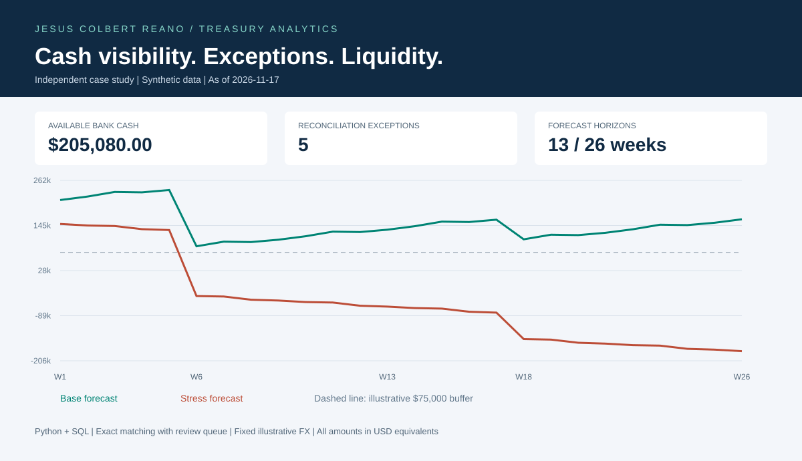

# Treasury Analytics

**Bank reconciliation, daily cash positioning and 13/26-week liquidity forecasting.**

An independent portfolio case study by **Jesús Colbert Reaño**, Financial Planning Analyst in Planning and Treasury. Built with AI assistance and intended to demonstrate a reproducible analytical approach. All company, account and transaction data are fictional. This is not a record of employer results.



## Start here

Read the [treasury review pack](reports/treasury_review.md) for cash balances, reconciliation exceptions, forecast assumptions and management discussion. The [source data](data/synthetic_case.json), [Python engine](treasury.py), [SQL queries](queries.sql) and [tests](tests/test_treasury.py) make every result inspectable.

## Business question

For a fictional fintech operating bank accounts in USD and EUR, how much bank cash is available today, which transactions need investigation, and when could a liquidity buffer be breached?

## What the case demonstrates

| Treasury task | Deliverable | Control |
|---|---|---|
| Daily cash positioning | Available, restricted, kiosk and transit balances | Separate cash buckets; fixed FX assumptions disclosed |
| Bank reconciliation | Exact matches and review queue | Account, currency, reference, amount and date checks |
| Data quality | Duplicate ingestion check | Identical source duplicates excluded; conflicting IDs rejected |
| Liquidity planning | 13 and 26-week views | Opening + receipts - payments = closing |
| Stress testing | Collection delay, lower receipts and higher payments | First buffer breach and funding gap by week |
| Review support | Markdown review pack and SQL queries | Exceptions remain open until reviewed |

## Run locally

Python 3.10 or newer. No external Python packages, API keys or bank connection required.

```sh
python treasury.py
python -m unittest discover -s tests -v
```

Outputs appear in `reports/`: a readable review pack, a self-contained SVG preview, complete JSON results and a local SQLite database. The database is regenerated and excluded from Git. Rerunning replaces only these demo outputs.

## Inputs and assumptions

- `data/synthetic_case.json` contains integer amounts in cents, account balances, transaction dates, fixed FX assumptions and a 26-week external cash-flow schedule.
- Reporting date: 17 November 2026. The first weekly bucket starts on 18 November. These dates freeze the case for reproducibility.
- EUR/USD is an illustrative 1.10, not a live exchange rate. Cross-currency cash is assumed transferable without fees; real entity and currency constraints would require separate forecasts.
- USD 10,000 is restricted; USD 18,000 is in kiosks and USD 12,000 is in transit. None of these balances is included in available bank cash. The ledger deposit of USD 6,000 is included within the transit bucket.
- An identical imported bank row is excluded by source ID. Reused references with distinct IDs are ambiguous, not silently deduplicated.
- The weekly schedule includes a USD 155,000 equipment payment in week 6 and a USD 60,000 tax payment in week 18, on top of normal payments. These are scenario inputs, not recommendations.
- Stress assumes receipts 10% lower and delayed one week, and payments 8% higher. The illustrative buffer is USD 75,000. Timing delays can move receipts beyond the reporting horizon.

## Scope and judgment

This is a prototype for analytical review, not a production treasury system. No automatic journals, payments or bank actions are performed. Differences are not forced to zero. The unidentified receipt is provisionally included in bank liquidity and requires assessment before it can be treated as freely usable.

The case does not demonstrate hands-on NetSuite, Kyriba, FIS or ION integration, professional accounting certification, digital-asset custody or international accounting compliance. Those capabilities cannot be inferred from a Python model.

For a production workflow, I would confirm opening balances and bank cutoffs, obtain approved payment and collection schedules, assign exception owners, preserve source lineage and apply treasury review and sign-off before reporting final figures.

## About the author

My background combines financial planning, cash-flow work, Python-assisted bank reconciliation automation, Excel, Power BI and SQL. This case illustrates how those skills can support treasury operations.

[Professional portfolio](https://jesuscolbert.github.io/portafolio-jesus-colbert/) · [GitHub](https://github.com/jesuscolbert)

## Resumen en español

Caso práctico con datos ficticios: concilia movimientos bancarios, separa caja disponible, restringida, en quioscos y en tránsito, y proyecta liquidez a 13 y 26 semanas. Incluye controles, excepciones pendientes de revisión y un escenario de estrés. Para explicar el caso en entrevista, comienza por el reporte y luego muestra cómo se puede rastrear cada resultado hasta los datos y las reglas del modelo.
